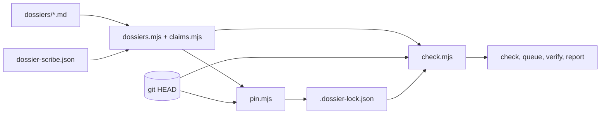

# dossier-scribe: how it is built

A command line tool in plain Node 22 ES modules with no dependencies. It reads markdown docs and the git history of the repo they describe, and writes a lock file, reports and task files. <!-- src: package.json#type, package.json#engines.node, test/cli.test.mjs:77-84 -->

## Components

- Entry point: `bin/dossier-scribe.mjs` calls `main` in `src/cli.mjs`, which splits the global `--root`, loads the config, and imports the command module by name. <!-- src: bin/dossier-scribe.mjs:1-4, src/cli.mjs:45-65 -->
- Commands: `init`, `lint`, `pin`, `check`, `queue`, `verify`, `auto`, `report` and `demo`, one module each in `src/commands/`. `demo` is the only one that skips the config. <!-- src: src/cli.mjs:33-43, src/cli.mjs:54 -->
- Config: `src/config.mjs` reads `dossier-scribe.json` and merges it over defaults. Unknown collector names and a bad `uncitedSeverity` are usage errors. <!-- src: src/config.mjs:7-41 -->
- Dossier loader: `src/dossiers.mjs` lists the `.md` files in the dossiers folder, parses frontmatter with `src/frontmatter.mjs` and extracts claims with `src/claims.mjs`. <!-- src: src/dossiers.mjs:22-62, src/frontmatter.mjs:19-54, src/claims.mjs:19-121 -->
- Git wrapper: `src/git.mjs` is a thin batched layer over the `git` CLI: one `ls-tree` for the tree, one `cat-file --batch` for blobs, and `log` and `diff --numstat` for drift detail. <!-- src: src/git.mjs:13-17, src/git.mjs:48-58, src/git.mjs:63-67, src/git.mjs:93-121 -->
- Pin and check: `src/pin.mjs` builds lock records, and `src/check.mjs` compares them with HEAD and labels each claim `ok`, `stale`, `moved`, `broken`, `new`, `removed` or `uncited`. <!-- src: src/pin.mjs:94-154, src/check.mjs:26-172 -->
- Lint: `src/lint.mjs` checks frontmatter, that cited paths, keys and ranges exist at HEAD, and duplicate slugs. <!-- src: src/lint.mjs:14-88 -->
- Queue tasks: `src/task.mjs` builds one re-verify task per drifted doc and renders it as markdown, JSON or a coding-agent prompt. <!-- src: src/task.mjs:18-144, src/commands/queue.mjs:11-15 -->
- Collectors: `src/collectors.mjs` reads committed manifests for the auto block (package, python, go, rust, docker, env names, git totals, file types, systemd units). <!-- src: src/collectors.mjs:11-173 -->
- Report: `src/report.mjs` renders the static index as one HTML page or a markdown table. <!-- src: src/report.mjs:29-40, src/report.mjs:67-143 -->
- Self checks in CI: the `action` job runs `action.yml`, a composite action that runs `lint` then `check` against this repo's own dossiers. <!-- src: .github/workflows/ci.yml:34-41, action.yml:22-44 -->

## Data flow

- `pin`: load config and dossiers, lint every citation and refuse a doc with errors, record each cited claim's files and hashes against HEAD, set `last_verified`, write the lock. <!-- src: src/commands/pin.mjs:9-31, src/pin.mjs:94-154 -->
- `check`: load the lock, expand each claim's sources against the HEAD tree, and compare. A whole file is compared by blob id, a line range by a hash of just those lines, a JSON key by a hash of just that value, and a glob by its list of matches. <!-- src: src/check.mjs:26-72, src/pin.mjs:12, src/pin.mjs:49-64 -->
- A range whose lines are unchanged but sit elsewhere is `moved`, not `stale`, and a deleted or renamed file or removed key is `broken`. <!-- src: src/check.mjs:26-72 -->
- For stale and broken claims `check` adds the commits since the pin, a diffstat and rename detection with a few batched git calls per doc, not one per claim. <!-- src: src/check.mjs:174-202 -->
- `check` exits 1 when a state named in `--fail-on` is present, which defaults to `stale,broken`. <!-- src: src/commands/check.mjs:18-37 -->
- `queue`: run `check`, take the docs with stale or broken claims, skip any inside the cooldown or past the daily cap, and write one task file each, optionally piping it to `--dispatch-cmd` through `sh -c`. <!-- src: src/commands/queue.mjs:36-93 -->
- `auto` replaces only the text between the auto markers with collector output, and appends a block when the doc has none. <!-- src: src/commands/auto.mjs:8-18 -->

## Storage

- The lock, `.dossier-lock.json`, sits in the dossiers folder: version 1, then per doc a pin time, the HEAD at the pin and a record per claim. <!-- src: src/lock.mjs:5, src/lock.mjs:21-25, src/pin.mjs:94-154 -->
- Queue state, `.dossier-state.json`, sits beside it and holds when each doc was last queued and how many tasks went out today. <!-- src: src/lock.mjs:6, src/commands/queue.mjs:57-92 -->
- Task files go to `dossier-tasks` unless `--out` says otherwise, and the report goes to `index.html` unless `--out` says otherwise. <!-- src: src/commands/queue.mjs:22, src/commands/report.mjs:19 -->
- There is no database, cache or other state. Every git read is against `HEAD`, so uncommitted edits are not seen. <!-- src: src/git.mjs:48-58, src/commands/pin.mjs:28 -->
- This repo pins its docs from `dossiers/`: the self dossier plus links to `AGENTS.md` and `docs/ARCHITECTURE.md`. <!-- src: dossier-scribe.json -->

## Auth

No login, tokens or roles: it is a local CLI that runs with the caller's file and git permissions. Cited paths must be relative to the repo and cannot contain `..`. <!-- src: src/claims.mjs:127-159 -->

## External services

- It calls none: no network and no model. It spawns the local `git` binary and, for `queue --dispatch-cmd`, a shell command the user supplies. <!-- src: src/git.mjs:13-17, src/commands/queue.mjs:75-80, CONTRIBUTING.md:8 -->
- The env collector records variable names from `.env.example` style files and never their values. <!-- src: src/collectors.mjs:125-138 -->
- `DSCRIBE_NOW` overrides the clock for tests. The dispatch command gets `DSCRIBE_SLUG` and `DSCRIBE_TASK_FILE`. <!-- src: src/util.mjs:5-12, src/commands/queue.mjs:75-78 -->
- Release automation, which is not part of the tool: `scripts/release.mjs` asks the npm registry and the `gh` CLI what is already published, and the publish workflow uses `NPM_TOKEN` and `GH_TOKEN`. <!-- src: scripts/release.mjs:83-95, .github/workflows/publish.yml:50-56 -->

## Unverified

- None.

## Generated facts

<!-- auto:start -->
- package: dossier-scribe 0.2.1
- npm scripts (1): test
<!-- auto:end -->
